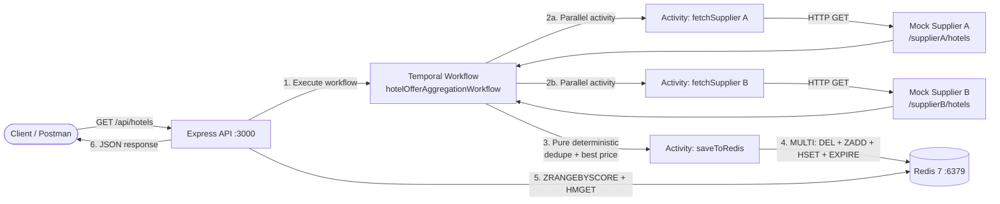

# Hotel Offer Orchestrator

A Node.js (TypeScript) backend service that aggregates overlapping hotel offers from two mock suppliers using **Temporal** for durable workflow orchestration, deduplicates offers to pick the lowest price per hotel, and stores/filters results by price range in **Redis**.

## Architecture



### Request Lifecycle

1. **Validate:** Express synchronously validates `city`, `minPrice`, and `maxPrice` before starting a workflow.
2. **Orchestrate:** `hotelOfferAggregationWorkflow` invokes `fetchSupplier('A', city)` and `fetchSupplier('B', city)` in parallel via `Promise.allSettled` (each with 3 retry attempts and exponential backoff).
3. **Deduplicate:** A pure, deterministic function inside the workflow merges offers by normalized hotel name (`name.trim().toLowerCase()`), keeping the lower `price` (tie-breaking on **lower** `commissionPct`, then Supplier A). If one supplier fails, the workflow logs a warning and proceeds with the surviving supplier.
4. **Persist & Filter:** `saveToRedis` atomically writes the deduplicated list to Redis with a 5-minute TTL. Once the workflow completes, the API reads the response through Redis `ZRANGEBYSCORE` + `HMGET` so every request is consistently filtered and sorted by price.

## Redis Design

This project uses plain Redis (`redis:7-alpine`, no RediSearch) with two keys per normalized city (`c = city.trim().toLowerCase()`), both expiring after **300 seconds**:

| Key | Type | Contents |
| :--- | :--- | :--- |
| `hotels:city:{c}:prices` | Sorted Set (`ZSET`) | Member = normalized hotel name, Score = numeric `price` |
| `hotels:city:{c}:details` | Hash (`HASH`) | Field = normalized hotel name, Value = JSON `{ name, price, supplier, commissionPct }` |

**Why a Sorted Set for price filtering?**
* `ZRANGEBYSCORE hotels:city:{c}:prices <min> <max>` executes price-range queries in **O(log N + M)** time directly inside Redis and returns hotel keys already sorted ascending by price.
* Omitted bounds map cleanly to `-inf` and `+inf`.
* Pairing the `ZSET` with a single per-city `HASH` allows atomic `MULTI/EXEC` replacement (`DEL` → `ZADD` → `HSET` → `EXPIRE`) and a single `HMGET` round trip to hydrate matching offers.

## Prerequisites

* [Docker](https://docs.docker.com/get-docker/) and Docker Compose v2 (`docker compose`)
* `curl` (optional, for CLI verification)
* [Postman](https://www.postman.com/) (optional, for running `postman_collection.json`)

## Setup & Run

```bash
# Clone the repository and enter the project directory
git clone <your-repo-url>
cd hotel-offer-orchestrator

# Build images and start all 6 services (temporal-db, temporal, temporal-ui, redis, app, worker)
docker compose up --build
```

To run in detached mode:

```bash
docker compose up --build -d
```

Verify that all services are healthy:

```bash
docker compose ps
curl http://localhost:3000/health
```

Stop and remove containers and volumes:

```bash
docker compose down -v
```

## Service Ports & URLs

| Service | Host Port | URL / Endpoint | Purpose |
| :--- | :--- | :--- | :--- |
| `app` | `3000` | `http://localhost:3000` | Express API, `/health`, and mock suppliers |
| `temporal-ui` | `8080` | `http://localhost:8080` | Temporal Web UI (inspect workflows, retries, histories) |
| `temporal` | `7233` | `localhost:7233` | Temporal Server gRPC frontend |
| `redis` | `6379` | `localhost:6379` | Plain Redis 7 store & price index |
| `temporal-db` | `5432` | `localhost:5432` | PostgreSQL 16 persistence for Temporal |
| `worker` | — | Internal only | Temporal Worker polling `hotel-offers-queue` |

## API Documentation

### `GET /api/hotels`

Aggregates, deduplicates, caches, and filters hotel offers for a city.

**Query Parameters:**
* `city` *(required)* — Non-empty city name (case-insensitive, e.g. `delhi`, `mumbai`).
* `minPrice` *(optional)* — Non-negative number (defaults to `-inf` in Redis).
* `maxPrice` *(optional)* — Non-negative number (defaults to `+inf` in Redis).

**Example — Deduplicated offers for Delhi (abridged: first 4 of 10, sorted by price):**

```bash
curl "http://localhost:3000/api/hotels?city=delhi"
```

```json
[
  { "name": "Bloomrooms", "price": 3200, "supplier": "Supplier A", "commissionPct": 8 },
  { "name": "Lemon Tree", "price": 4100, "supplier": "Supplier B", "commissionPct": 12 },
  { "name": "Holtin", "price": 5340, "supplier": "Supplier B", "commissionPct": 20 },
  { "name": "Radison", "price": 5900, "supplier": "Supplier A", "commissionPct": 13 }
]
```

**Example — Price-filtered offers:**

```bash
curl "http://localhost:3000/api/hotels?city=delhi&minPrice=5000&maxPrice=7500"
```

**Example — Unknown city (`200 OK`):**

```bash
curl "http://localhost:3000/api/hotels?city=jaipur"
# []
```

**Error Responses:**
* `400 Bad Request` — Missing `city`, non-numeric/negative price, or `minPrice > maxPrice`:
  ```json
  { "error": "'minPrice' cannot be greater than 'maxPrice'." }
  ```
* `502 Bad Gateway` — Both Supplier A and Supplier B failed after Temporal retries:
  ```json
  { "error": "All hotel suppliers failed to respond." }
  ```

### `GET /health`

Probes Redis (`PING`) and both mock supplier endpoints.

```bash
curl "http://localhost:3000/health"
```

* `200 OK` (`"status": "ok"` when Redis and both suppliers are up; `"status": "degraded"` if one or both suppliers are down so Docker Compose keeps `app` reachable during outage tests):
  ```json
  {
    "status": "ok",
    "redis": "up",
    "suppliers": { "supplierA": "up", "supplierB": "up" }
  }
  ```
* `503 Service Unavailable` when Redis is unreachable.

### Mock Supplier Endpoints

* `GET /supplierA/hotels?city=delhi` — Raw Supplier A listings.
* `GET /supplierB/hotels?city=delhi` — Raw Supplier B listings.

## Importing the Postman Collection

1. Open Postman and click **Import** (top-left).
2. Select `postman_collection.json` from the repository root.
3. The collection defines a `{{baseUrl}}` variable defaulting to `http://localhost:3000`.
4. Run individual requests or use **Collection Runner** to execute all built-in assertions (deduplication, price filtering, validation errors, direct supplier checks, and `/health`).

## Simulating a Supplier Failure

Use `SUPPLIER_B_DOWN` (or `SUPPLIER_A_DOWN`) to make the corresponding mock supplier return `503 Service Unavailable`:

```bash
# 1. Restart app with Supplier B simulated down
SUPPLIER_B_DOWN=true docker compose up -d app

# 2. Verify /health reports degraded status
curl "http://localhost:3000/health"
# {"status":"degraded","redis":"up","suppliers":{"supplierA":"up","supplierB":"down"}}

# 3. Verify /api/hotels still succeeds using Supplier A's offers
curl "http://localhost:3000/api/hotels?city=delhi"

# 4. Inspect the 3 failed activity retries in Temporal UI: http://localhost:8080

# 5. Restore normal operation
SUPPLIER_B_DOWN=false docker compose up -d app
```

## Design Decisions & Trade-offs

* **Pure deduplication inside the workflow:** Keeping deduplication deterministic and side-effect-free inside `hotelOfferAggregationWorkflow` guarantees safe Temporal event-history replay without paying for an extra activity hop.
* **Always serving via Redis after workflow completion:** Reading `/api/hotels` through `ZRANGEBYSCORE` + `HMGET` even when no price filters are supplied guarantees a single, consistent read path and price-sorted output.
* **Debian slim (`node:20-bookworm-slim`) instead of Alpine:** `@temporalio/core-bridge` ships glibc-linked native binaries; using `bookworm-slim` avoids Alpine/musl compatibility failures while keeping the multi-stage runtime image lean.
* **Shared image, separate `app` and `worker` services:** Both containers build from one `Dockerfile` with different `command` entrypoints, mirroring production separation of API and worker scaling without duplicating build steps.
* **`temporalio/auto-setup` for local compose:** Automatically initializes the PostgreSQL schema and `default` namespace on first boot, trading production-grade migration control for zero-friction local startup.

## Limitations & What I'd Improve Next

* **Cache-aside reads:** Currently every `GET /api/hotels` request triggers a fresh Temporal workflow. In production, I would check Redis first and only trigger a workflow on cache miss (or refresh asynchronously via stale-while-revalidate) to cut p95 latency.
* **Decoupled supplier services & resilience:** The mock suppliers run inside the Express `app` container. With real third-party suppliers, I would add per-supplier circuit breakers, rate limiting, and separate outbound timeouts.
* **Production Temporal deployment:** Replace `temporalio/auto-setup` with `temporalio/server`, external managed PostgreSQL, explicit schema migrations, and TLS/mTLS between workers and the Temporal frontend.
* **Automated test suite & observability:** Add unit tests for `dedupe.ts` and `validation.ts`, workflow replay/integration tests using `@temporalio/testing`, and OpenTelemetry tracing across Express, Temporal, and Redis.